> **Nota:** Els exercicis i pràctiques t'han de servir per familiaritzar-te amb el llenguatge PowerShell. Aprofita per fer diverses proves i veure què passa. Documenta també aquestes proves i els resultats.

# Treballar amb fitxers i carpetes

**Situació:** encara no hem estudiat les ordres de PowerShell per treballar amb fitxers i carpetes. Les haurem de descobrir utilitzant les eines d'ajuda de PowerShell.

## 1. Buscar ordres

Busca cmdlets que continguin la paraula `Item`:

```powershell
Get-Command *Item*
```

Observa les ordres que apareixen.

Intenta identificar quina ordre podria servir per:

- crear un element;
- eliminar un element;
- canviar el nom d'un element;
- copiar un element;
- moure un element.

> He executat la comanda i he identificat les ordres següents:

| Acció | Cmdlet |
|---|---|
| Crear | `New-Item` |
| Eliminar | `Remove-Item` |
| Canviar el nom | `Rename-Item` |
| Copiar | `Copy-Item` |
| Moure | `Move-Item` |

---

## 2. Investigar una ordre

Sense executar-la encara, consulta què fa:

> `Get-Help New-Item` mostra una descripció de la comanda i de la seva sintaxi.

```powershell
Get-Help New-Item
```

Respon:

- Per a què serveix `New-Item`?

> `New-Item` serveix per crear un element nou, per exemple, un fitxer o una carpeta.

- Quina estructura té l'ordre?

> Sintaxi mostrada per l’ajuda:

```text
New-Item [-Path] <string[]>  [<CommonParameters>]

New-Item [[-Path] <string[]>]  [<CommonParameters>]
```

Consulta alguns exemples:

```powershell
Get-Help New-Item -Examples
```

---

## 3. Descobrir un paràmetre

Consulta què significa el paràmetre `-ItemType`:

```powershell
Get-Help New-Item -Parameter ItemType
```

A partir de l'ajuda, intenta descobrir com crear una carpeta.

Per exemple, haurien d'arribar a alguna cosa semblant a:

```powershell
New-Item -ItemType Directory -Name Prova
```

> He trobat la comanda anterior per crear una carpeta de tipus `Directory`.

---

## 4. Nou repte

Ara necessites saber com **canviar el nom de la carpeta**, però no coneixes l'ordre.

Utilitza:

```powershell
Get-Command *Item*
```

i després consulta l'ajuda de l'ordre que creguis adequada.

L'objectiu és arribar a descobrir:

```powershell
Rename-Item
```

i consultar:

```powershell
Get-Help Rename-Item -Examples
```

---

Sense utilitzar Internet, descobreix quins cmdlets faries servir per:

1. crear una carpeta;

> Per crear una carpeta he utilitzat el cmdlet `New-Item`.

> Primer he investigat el paràmetre `-ItemType` amb:

```powershell
Get-Help New-Item -Parameter ItemType
```

> He descobert que, per crear una carpeta, he d’utilitzar el tipus `Directory`.

> **Comanda executada:**

```powershell
New-Item -ItemType Directory -Name Prova
```

> **Resultat:**
> S’ha creat correctament una carpeta anomenada `Prova`.

> A la captura es veu la comanda executada:

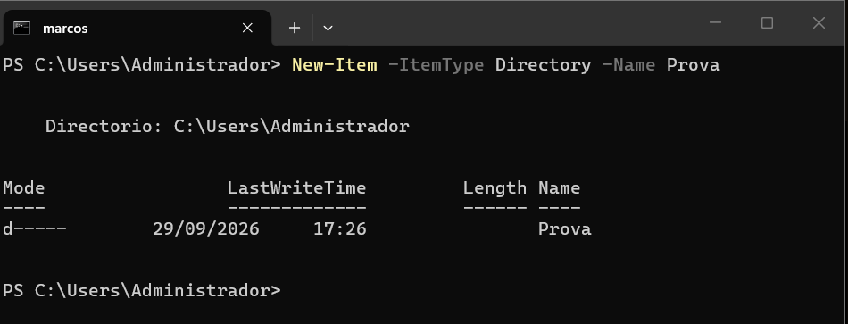

2. Canviar el nom;

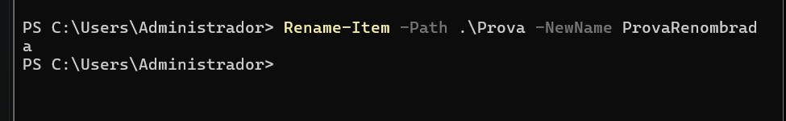

> He tornat a buscar els cmdlets amb:

```powershell
Get-Command *Item*
```

> He identificat `Rename-Item`.

> Després he consultat la seva ajuda:

```powershell
Get-Help Rename-Item
```

> I els exemples:

```powershell
Get-Help Rename-Item -Examples
```

> `Rename-Item` serveix per canviar el nom d’un element.

> **Comanda executada:**

```powershell
Rename-Item -Path .\Prova -NewName ProvaRenombrada
```

> **Resultat:**
> La carpeta `Prova` ha passat a anomenar-se `ProvaRenombrada`.

3. copiar-la;

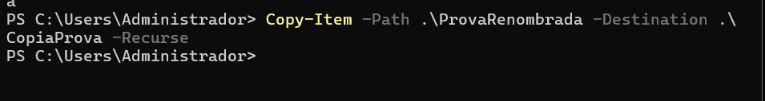

> Amb `Get-Command *Item*` he identificat el cmdlet `Copy-Item`.

> He consultat:

```powershell
Get-Help Copy-Item
Get-Help Copy-Item -Examples
```

> `Copy-Item` permet copiar un element.

> **Comanda executada:**

```powershell
Copy-Item -Path .\ProvaRenombrada -Destination .\CopiaProva -Recurse
```

> **Resultat:**
> S’ha creat una còpia de la carpeta amb el nom `CopiaProva`.

4. moure-la;

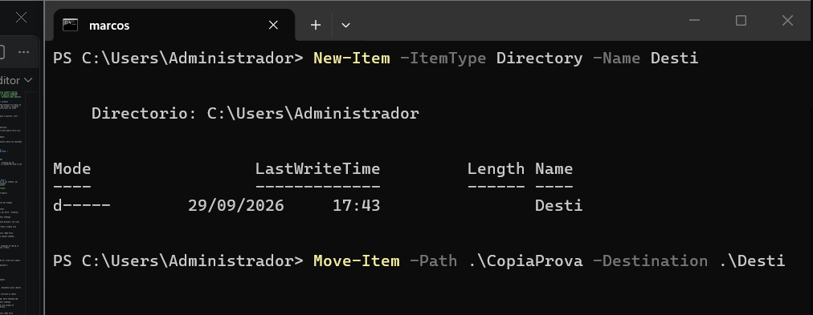

> He identificat el cmdlet `Move-Item` utilitzant:

```powershell
Get-Command *Item*
```

> He investigat el cmdlet amb:

```powershell
Get-Help Move-Item
Get-Help Move-Item -Examples
```

> `Move-Item` permet moure un element d’una ubicació a una altra.

> Primer he creat una carpeta anomenada `Desti`:

```powershell
New-Item -ItemType Directory -Name Desti
```

> Després he executat:

```powershell
Move-Item -Path .\CopiaProva -Destination .\Desti
```

> **Resultat:**
> La carpeta `CopiaProva` s’ha mogut dins de la carpeta `Desti`.

5. eliminar-la.

> Amb:

```powershell
Get-Command *Item*
```

> He identificat:

```powershell
Remove-Item
```

> He consultat l’ajuda:

```powershell
Get-Help Remove-Item
```

> I els exemples:

```powershell
Get-Help Remove-Item -Examples
```

> `Remove-Item` serveix per eliminar un element.

> He executat:

```powershell
Remove-Item -Path .\Desti\CopiaProva -Recurse
```

> **Resultat:**

> La carpeta `CopiaProva` ha estat eliminada.

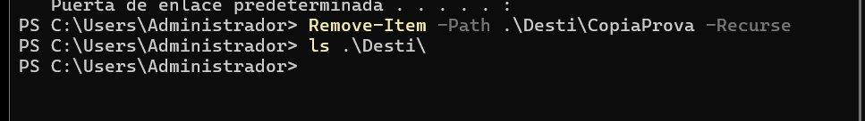

**Condició:** només pots utilitzar `Get-Command` i `Get-Help` per investigar les ordres.

# Descobrir ordres de xarxa amb PowerShell

## Situació

Estàs administrant un servidor Windows i necessites consultar informació de la seva configuració de xarxa.

Encara no coneixes les ordres de PowerShell relacionades amb xarxa.

La teva feina és descobrir-les utilitzant principalment:

```powershell
Get-Command
Get-Help
```

No pots buscar les respostes a Internet.

---

## Tasques

Descobreix quines ordres de PowerShell et permeten obtenir la informació següent:

1. Mostrar els adaptadors de xarxa de l’equip.

> Busco ordres relacionades amb els adaptadors de xarxa:

```powershell
Get-Command *NetAdapter*
```

> **Cmdlet trobat:**

```powershell
Get-NetAdapter
```

> **Ajuda:**

```powershell
Get-Help Get-NetAdapter
```

> També consulto els exemples:

```powershell
Get-Help Get-NetAdapter -Examples
```

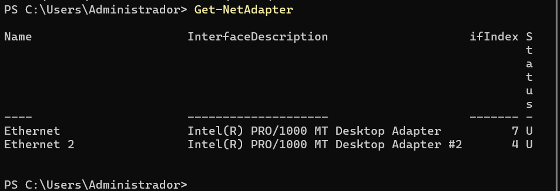

2. Consultar les adreces IP configurades.

> **Cerca:**

```powershell
Get-Command *IPAddress*
```

> **Cmdlet trobat:**

```powershell
Get-NetIPAddress
```

> **Ajuda:**

```powershell
Get-Help Get-NetIPAddress

Get-Help Get-NetIPAddress -Examples
```

> **Explicació:**

> `Get-NetIPAddress` permet consultar les adreces IP configurades a les diferents interfícies de xarxa.

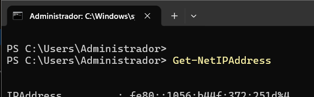

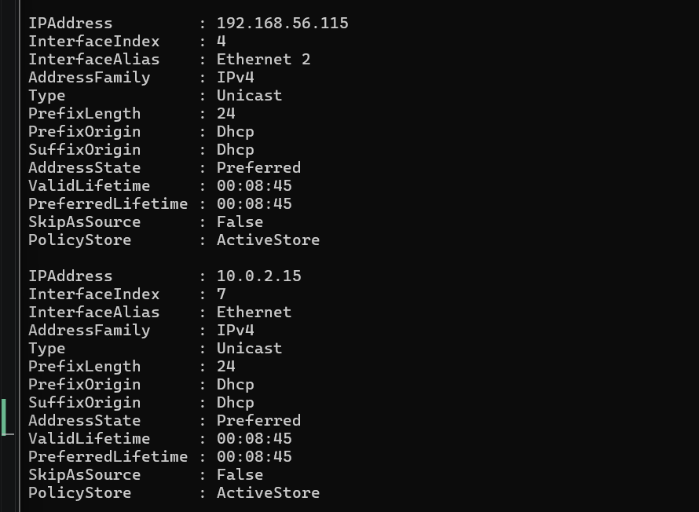

> Aquí es veuen les dues IP que tinc configurades: una per accedir a Internet i l’altra per accedir per SSH al Windows Server Core.

3. Consultar la configuració IP completa dels adaptadors de xarxa.

> **Cerca:**

```powershell
Get-Command *IPConfiguration*
```

> **Cmdlet trobat:**

```powershell
Get-NetIPConfiguration
```

> **Ajuda:**

```powershell
Get-Help Get-NetIPConfiguration

Get-Help Get-NetIPConfiguration -Examples
```

> **Explicació:**

> `Get-NetIPConfiguration` permet consultar la configuració IP de les interfícies de xarxa.

> **Comanda executada:**

```powershell
Get-NetIPConfiguration
```

> **Resultat:**

> S’ha mostrat la configuració IP de les interfícies de xarxa.

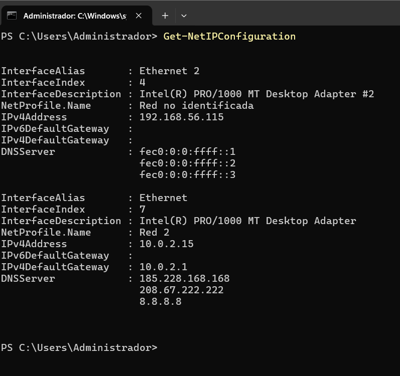

4. Consultar els servidors DNS configurats.

> **Cerca:**

```powershell
Get-Command *Dns*
```

> **Cmdlet trobat:**

> Entre els resultats he trobat:

```powershell
Get-DnsClientServerAddress
```

> **Ajuda:**

```powershell
Get-Help Get-DnsClientServerAddress

Get-Help Get-DnsClientServerAddress -Examples
```

> **Explicació:**

> `Get-DnsClientServerAddress` permet consultar les adreces dels servidors DNS configurats a les interfícies de xarxa.

> **Comanda executada:**

```powershell
Get-DnsClientServerAddress
```

> **Resultat:**

> S’han mostrat els servidors DNS configurats a les diferents interfícies.

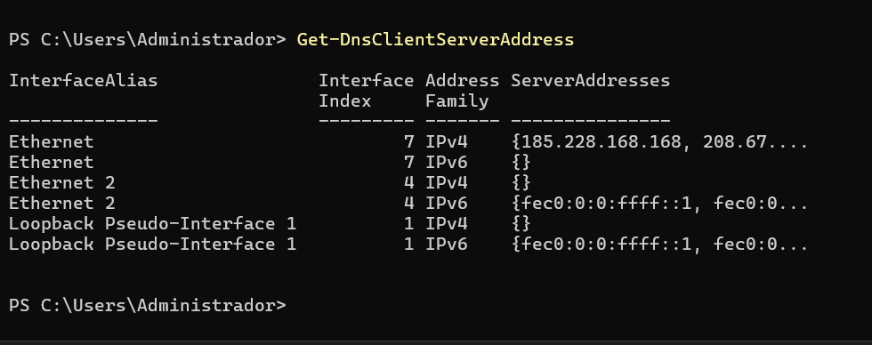

5. Comprovar si hi ha connectivitat amb un altre equip de la xarxa.

> **Cerca:**

```powershell
Get-Command *Connection*
```

> **Cmdlet trobat:**

```powershell
Test-Connection
```

> **Ajuda:**

```powershell
Get-Help Test-Connection

Get-Help Test-Connection -Examples
```

> **Explicació:**

> `Test-Connection` permet comprovar si un altre dispositiu de la xarxa respon a les peticions ICMP.

> **Comanda executada:**

> He utilitzat `Test-Connection` amb la IP de la meva màquina real a la xarxa host-only:

```powershell
Test-Connection 192.168.56.106
```

> **Resultat:**

> La comanda mostra si l’equip de destinació respon a les peticions.

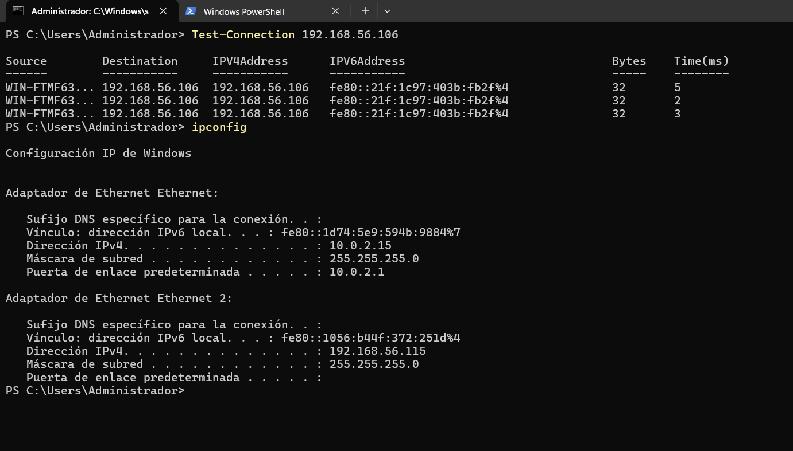

---

## Per cada tasca

Indica:

- el cmdlet que has trobat;
- com l’has localitzat amb `Get-Command`;
- una breu explicació del que fa;
- la comanda que has executat;
- el resultat obtingut.

L'objectiu és que hi hagi una traçabilitat de com s'ha arribat a la comanda final.
