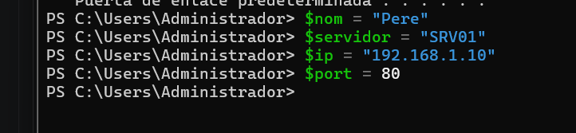
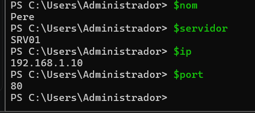
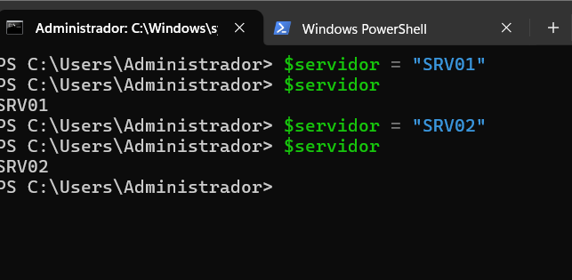
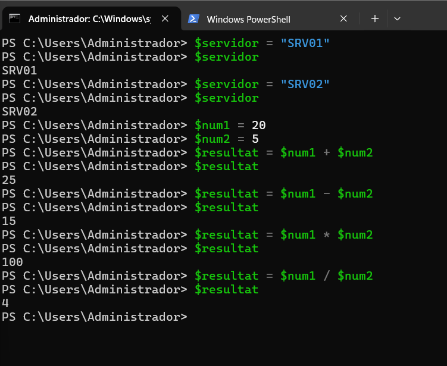
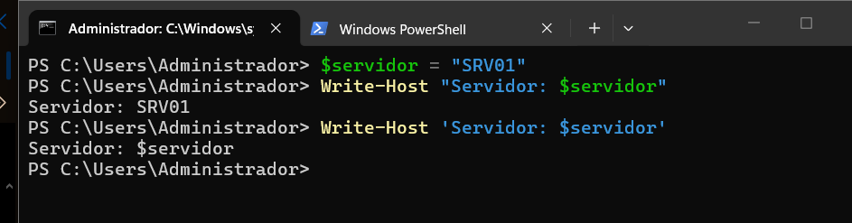
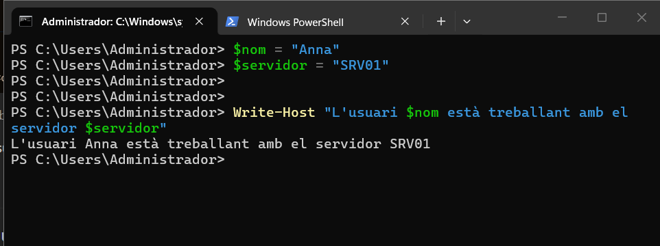
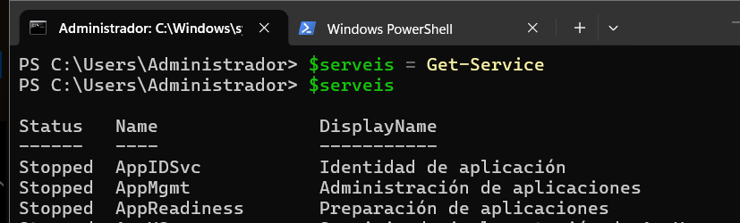
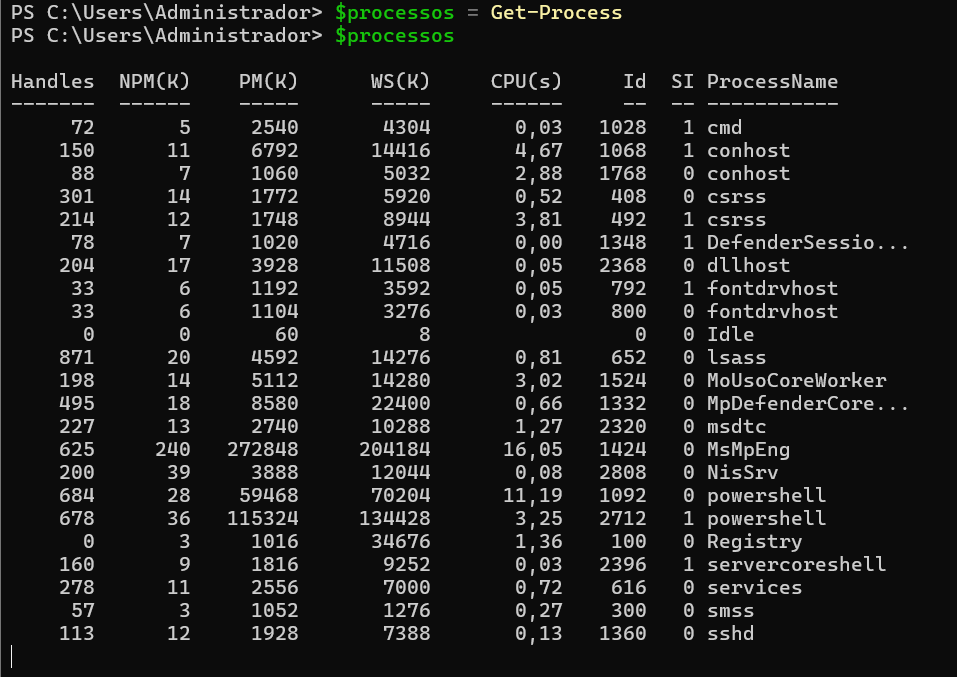
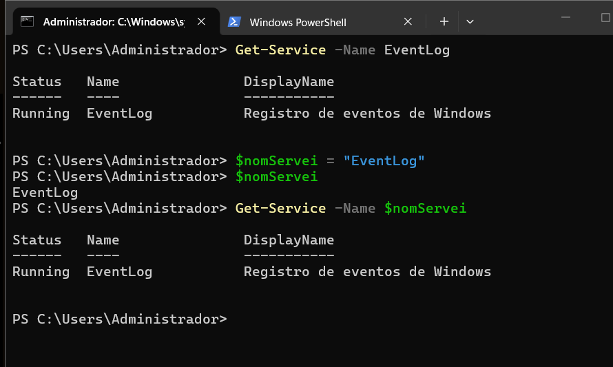

> **Nota:** Els exercicis i pràctiques t'han de servir per familiaritzar-te amb el llenguatge PowerShell. Aprofita per fer diverses proves i veure què passa. Documenta també aquestes proves i els resultats.

# Treballar amb variables

## 1. Crear variables

Crea les variables següents:

```powershell
$nom
$servidor
$ip
$port
```

Assigna-hi valors.

Per exemple:

```powershell
$nom = "Pere"
```

Mostra després el contingut de cadascuna de les variables.



> Per consultar-ne el contingut:



---

## 2. Modificar una variable

Crea:

```powershell
$servidor = "SRV01"
```

Mostra el seu valor.

Després canvia'l per:

```text
SRV02
```

Comprova quin valor conserva la variable.

---



> Aquí es veu que, si canviem el valor d’una variable, conserva l’últim valor que li hem assignat.

## 3. Operacions

Crea dues variables:

```powershell
$num1 = 20
$num2 = 5
```

Crea una tercera variable que guardi:

- la suma;
- la resta;
- la multiplicació;
- la divisió.

Per exemple:

```powershell
$resultat = $num1 + $num2
```

Mostra cada resultat.



> Hem declarat `$num1` i `$num2` i hem guardat cada càlcul a `$resultat`. El valor de `$resultat` canvia en cada operació, mentre que els valors de les variables originals es mantenen.

---

## 4. Variables dins d'un text

Crea:

```powershell
$nom = "Anna"
$servidor = "SRV01"
```

Intenta obtenir aquesta sortida:

```text
L'usuari Anna està treballant amb el servidor SRV01
```

utilitzant les variables dins del text.

> Per fer-ho, hem escrit un text entre cometes dobles amb les variables, com es veu a la captura següent:



---

## 5. Cometes

Executa:

```powershell
$servidor = "SRV01"
```

Després:

```powershell
Write-Host "Servidor: $servidor"
```

i:

```powershell
Write-Host 'Servidor: $servidor'
```

Respon:



**Quina diferència observes? Per què creus que passa?**

> Amb cometes dobles, PowerShell substitueix les variables pel seu valor. Amb cometes simples, el text es mostra literalment; per això apareix `Servidor: $servidor`.

---

## 6. Guardar el resultat d'una ordre

Executa:

```powershell
$serveis = Get-Service
```

Després:

```powershell
$serveis
```



Respon:

- Què creus que conté `$serveis`?

> Conté els objectes dels serveis que retorna la comanda `Get-Service`.

- La variable conté un únic valor o diversos elements?

> Conté diversos elements dins d’un array.
> Ho podem comprovar amb la comanda següent, que en aquest cas retorna `117`:

```powershell
$serveis.Count
```

```text
117
```

Fes el mateix amb:

```powershell
$processos = Get-Process
```

i comprova el seu contingut.



> Aquí es veu com es guarden els objectes dels processos i com PowerShell els mostra en forma de taula.

> La variable `$processos` conté el resultat del cmdlet `Get-Process`.

> Per tant, conté diversos elements: objectes que representen els processos que s’estan executant al sistema.

> El contingut pot variar perquè els processos actius poden ser diferents en cada moment.

---

## 7. Aplicació a administració

Crea una variable:

```powershell
$nomServei = "Spooler"
```

Utilitza aquesta variable per consultar el servei amb:

```powershell
Get-Service -Name ...
```

L'objectiu és obtenir el mateix resultat que:

```powershell
Get-Service -Name Spooler
```

però **sense escriure `Spooler` directament en el cmdlet**.

> Per fer-ho, hem buscat un servei disponible, perquè en aquest equip no tenim `Spooler`, i n’hem guardat el nom en una variable. Després hem executat `Get-Service -Name` amb aquesta variable, com es veu a continuació:


