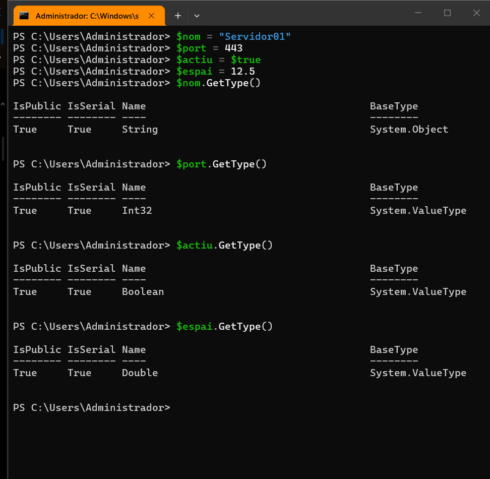
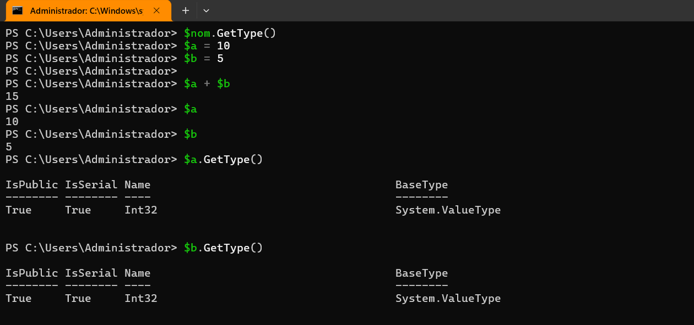
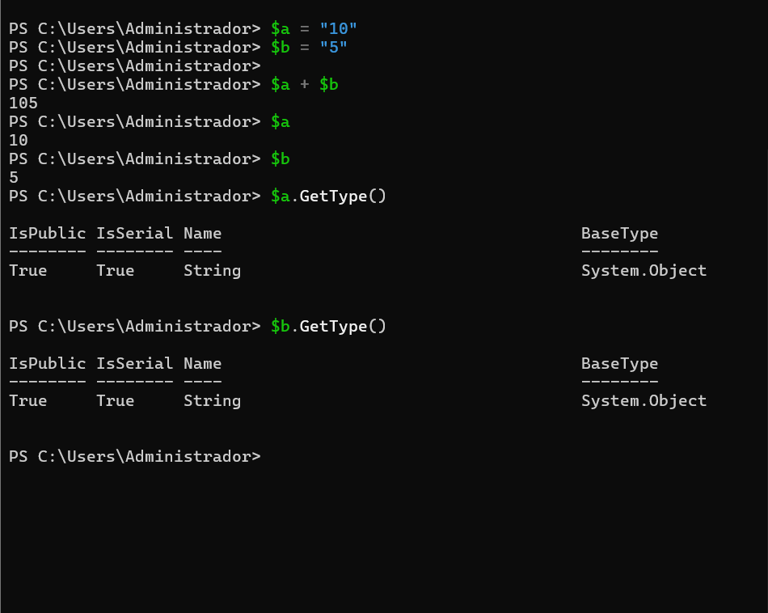
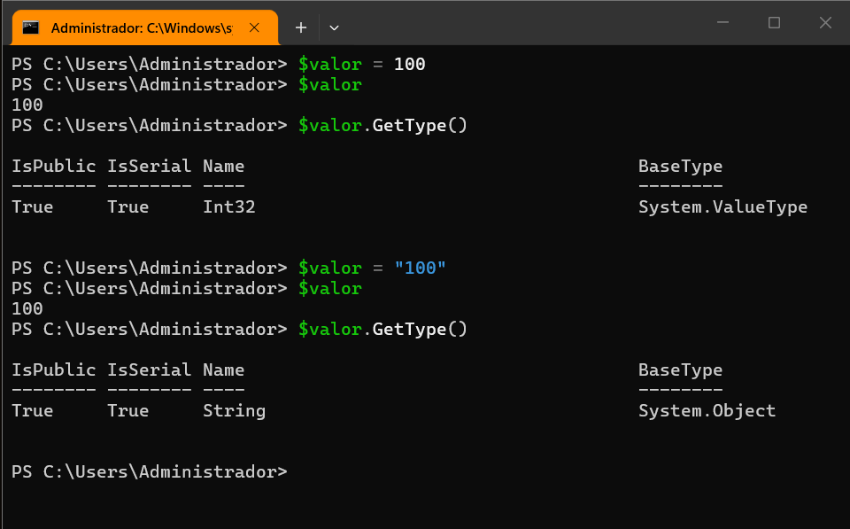
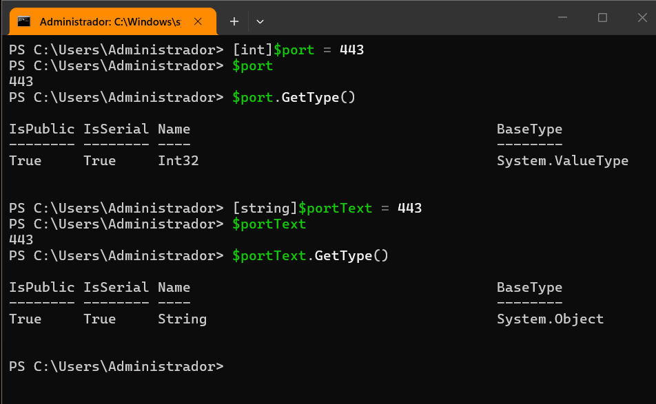
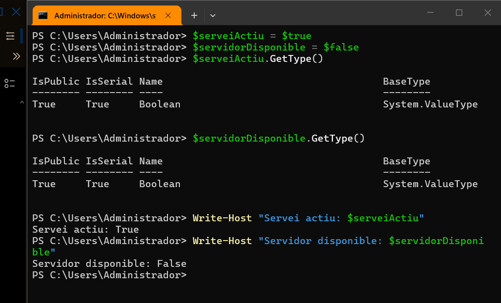
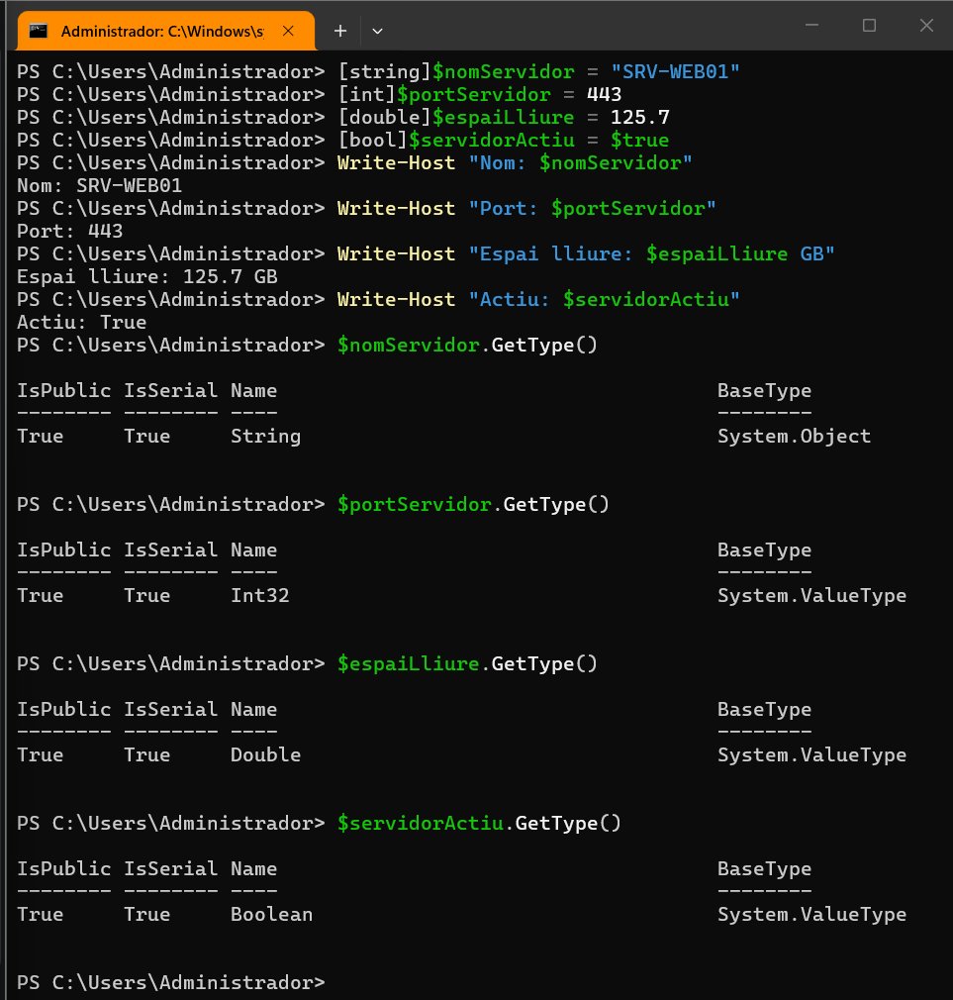

> **Nota:** Els exercicis i pràctiques t'han de servir per familiaritzar-te amb el llenguatge PowerShell. Aprofita per fer diverses proves i veure què passa. Documenta també aquestes proves i els resultats.

# Tipus de dades

## 1. Identificar tipus

Crea les variables següents:

```powershell
$nom = "Servidor01"
$port = 443
$actiu = $true
$espai = 12.5
```

Consulta el tipus de cadascuna amb:

```powershell
$nom.GetType()
$port.GetType()
$actiu.GetType()
$espai.GetType()
```

Completa una taula com aquesta:

| Variable | Valor        | Tipus |
| -------- | ------------ | ----- |
| `$nom` | `Servidor01` | |
| `$port` | `443` | |
| `$actiu` | `$true` | |
| `$espai` | `12.5` | |

> Per fer-ho, executem el següent:



> Hem declarat les variables i n’hem comprovat els tipus: `String`, `Int32`, `Boolean` i `Double`. Aquest últim representa un nombre amb decimals.

| Variable | Valor | Tipus |
|---|---|---|
| `$nom` | `Servidor01` | String |
| `$port` | `443` | Int32 |
| `$actiu` | `$true` | Boolean |
| `$espai` | `12.5` | Double |

## 2. Número o text?

Executa:

```powershell
$a = 10
$b = 5

$a + $b
```

Després:

```powershell
$a = "10"
$b = "5"

$a + $b
```

> Per fer-ho, executem les dues proves:





> Amb valors numèrics de tipus `Int32`, l’operació suma els nombres i retorna `15`. Amb valors de tipus `String`, concatena els textos `"10"` i `"5"` i retorna `"105"`.

## 3. Canviar el tipus d'una variable

Executa:

```powershell
$valor = 100
```

Consulta:

```powershell
$valor.GetType()
```

Ara executa:

```powershell
$valor = "100"
```

i torna a consultar:

```powershell
$valor.GetType()
```



> Primer hem assignat el nombre `100` a la variable i n’hem comprovat el tipus. Després li hem assignat `"100"` entre cometes, i el tipus ha canviat a `String`.

## 4. Tipus explícits

Executa:

```powershell
[int]$port = 443
```

Comprova el tipus:

```powershell
$port.GetType()
```

Ara prova:

```powershell
[string]$portText = 443
```

Consulta també:

```powershell
$portText.GetType()
```

Respon:

**Tot i que visualment els dos valors semblen `443`, són del mateix tipus?**



> No són del mateix tipus. Hem declarat `$port` explícitament com a `Int32` i `$portText` com a `String`, i ho hem comprovat amb `GetType()`. La declaració explícita força la conversió del valor al tipus indicat; per això, en aquest exemple, no cal posar cometes al `443` de `$portText`.

## 5. Booleans

Crea:

```powershell
$serveiActiu = $true
$servidorDisponible = $false
```

Consulta els tipus.

Després mostra un missatge amb:

```powershell
Write-Host "Servei actiu: $serveiActiu"
Write-Host "Servidor disponible: $servidorDisponible"
```



> Hem declarat una variable amb `$true` i l’altra amb `$false`. Hem comprovat que són de tipus `Boolean` i les hem mostrat amb `Write-Host`, juntament amb els missatges corresponents.

## 6. General

Crea variables per representar un servidor amb aquesta informació:

```text
Nom: SRV-WEB01
Port: 443
Espai lliure: 125.7 GB
Actiu: True
```

Després:

1. mostra el valor de totes les variables;
2. consulta el tipus de cadascuna;
3. indica quin tipus de dada has utilitzat per cada valor.



> Hem creat les variables amb el tipus declarat explícitament, com es veu a la captura. Després hem utilitzat `Write-Host` per mostrar cada valor amb la seva etiqueta i, finalment, `GetType()` per comprovar-ne el tipus.
